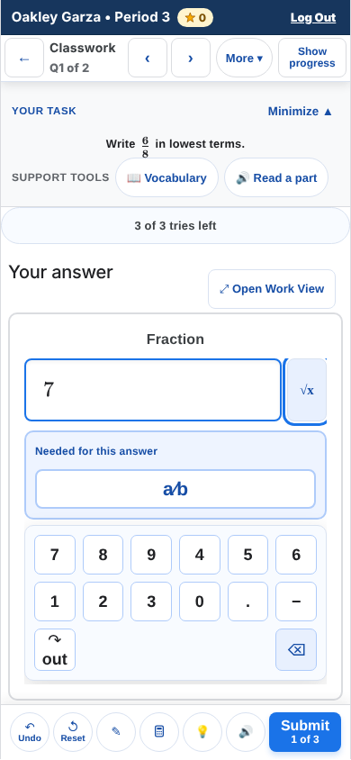
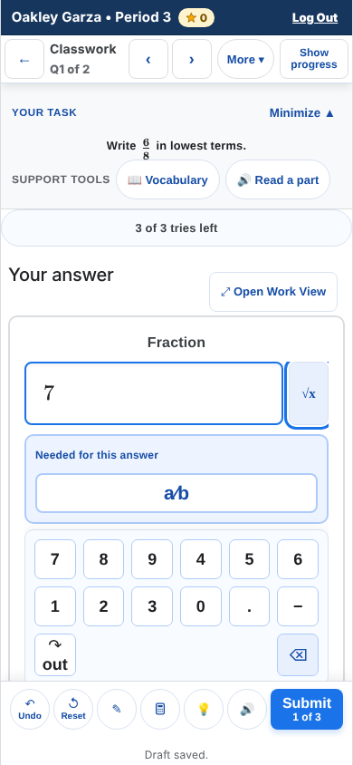
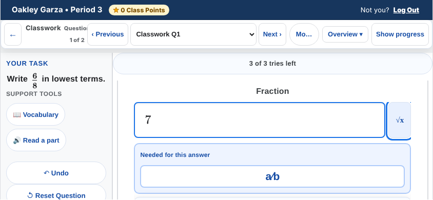
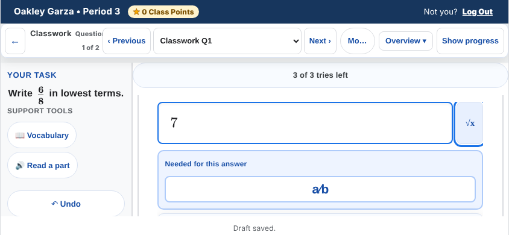

# Student pass 3, wave 7, W7-8 — the save line is seen on a phone

Branch `claude/pass3-phone-save-line`, from `claude/modest-pasteur-xzagn7` at `3cba9192` (`main` plus the seven
wave-7 branches). Nothing here grades, changes what a student is told, writes to Firebase or deploys. Student
words are unchanged.

## What a student saw

On a phone, the line under the question that says where the work is — "Draft saved.", "Saved on this device
only. MathMaster will finish saving when you are back online.", "Not saved · this device could not store your
last change…" — and the draft-save problem notice ("Some of your work on this assignment can only be saved on
this device…") were never on screen. The phone's question stage clips (`overflow: hidden !important`) and the
question inside it was exactly as tall as the stage (`height: 100%`), so everything App.jsx renders after the
question was laid out below the stage's box and clipped.

Measured on `3cba9192`, the real App (teacher harness, `questions=real`, Classwork Q1, after typing "7"):

| | Stage | Question (engine) | Action bar | "Draft saved." |
| --- | --- | --- | --- | --- |
| 390×844 | 91–843, overflow hidden | 91–843 | 782–843 | **851–874**: below the stage and below the screen |
| 844×390 (on its side) | 103–389, overflow hidden | 103–389 | in the prompt column | **397–420**: below the stage and the screen |
| 1366×768 | 103–814, overflow visible | 113–770 | 695–760 | 778–804 (the page scrolls to it) |

It is older than wave 7: W7-2's `student-assignments/completed-section` scene is the first large-text scene that
opens a lesson in the real App, and `studentShellLargeText.mjs --check=text` failed phone-200%, reflow-320 and
spacing-phone on it (`p. "Draft saved." cut by main.mathmaster-question-stage`). Re-run here on `3cba9192`
(`--only=student-assignments`): the same three fail.

| Before (`3cba9192`) | After |
| --- | --- |
|  |  |
|  |  |

At 200% text with the problem notice (after): [phone-save-line-after-notice-200pct.png](../qa/student-experience-pass-3/screenshots/phone-save-line-after-notice-200pct.png).

## What changed, and why this design

1. **`src/App.jsx`** — the lines App renders under the question (the save line, the draft-save problem notice, the
   device-reporting line, the DOL and Warm-Up "when time ends" lines and the after-the-close receipt) are wrapped in
   one `
`, inside the stage, after `QuestionEngine`. Nothing else
   moved; the spoken save announcement (`data-save-line-announcement`, absolutely positioned) stays where it was.
   The wrapper has no style outside phones: it has no padding or border, so its children's margins collapse
   through it exactly as before, and the Chromebook and desktop pixels are unchanged (proof below).
2. **`src/App.css`** (phone portrait, `(max-width: 768px) and (orientation: portrait)`) and
   **`src/components/student/MathToolMobileLayout.css`** (phone landscape, `(orientation: landscape) and
   (max-height: 500px)`) — the same three rules in each:
   - the stage keeps `overflow: hidden !important` and becomes a column (`display: flex; flex-direction: column`);
   - its children keep their own height (`flex: 0 0 auto`), and the question takes what is left
     (`> .mathmaster-question-engine { flex: 1 1 auto }`: from its own `height: 100%` of the stage, shrunk by the
     lines' height). The engine and container keep `height: 100%;
     max-height: 100%; min-height: 0`: a flexed item in a definite-height column is itself definite, so the
     question is still exactly as tall as the room it has and its columns scroll as before ("THE QUESTION IS AS
     TALL AS ITS STAGE, SO ITS COLUMNS SCROLL" holds — `stagedQuestion`, `planePhoneReach`,
     `phoneToolPanelReach` below);
   - the status element never takes more than **30% of the stage** and scrolls in place past it
     (`max-height: 30%; overflow-y: auto; overscroll-behavior: contain`).

3. **Added in the review round** (both in the phone blocks): inside the capped status box the first line keeps a
   4px top margin, not 8px (`> :first-child { margin-top: 4px !important }`, over the inline style; S1), and, upright,
   the task panel shrinks before the action bar is cut (`.mathmaster-question-container.mode-portrait >
   .question-prompt-panel { flex-shrink: 1; min-height: 44px }`, scoped to the assignment screen; B1). The work area
   still gives way first: its basis is 0, so the panel shrinks only once the work area is gone. See "Review round 1".

**Why `auto`, not `0`.** The first version used `flex: 1 1 0`. The gate caught it: `assignmentGraphingCalculator`
renders the stage without the assignment shell around it, so the stage has no set height there, and a basis of 0
collapsed the question to nothing on its phone pass (a click timed out on an element outside the viewport). With
`auto` an unsized stage lays out exactly as before, and a sized one (the real App) the same as with `0`. Every
browser run in the gate table is on the final CSS.

**Where the line sits, and the action bar.** On a portrait phone the action bar (`.portrait-action-bar`) is not
fixed: it is the last row of the question's own flex column (`position: relative`, `flex: 0 0 auto`), at the
bottom of the engine. So the status lines sit directly under the bar, at the bottom of the screen, and nothing
covers them; the bar moves up by the line's height (27px for "Draft saved.": a 4px margin and the line). In landscape the bar is static
inside the prompt column, and the line spans the screen's width under both columns. `--mm-action-bar-clearance`
(App.jsx, published from where the bar is) and `--mm-action-bar-height` lift toasts and scroll padding only; with
the bar inside the question neither needs to change. Safe-area insets are 0 in this app (`index.html` has no
`viewport-fit=cover`), so the line at the screen's edge is not under a home indicator.

**Why the 30% cap.** Without it, the browser check found a regression the first version had: at 390×844 and 200%
text the problem notice alone is 296px, and the column gave it all of that — the question kept only its prompt
and tries strip, and its action bar was cut in half by the question container's own clip (`B` below, red with the
cap removed). With the cap the bar is whole and the notice's first lines are in view; the rest scrolls inside the
status area. At 100% text nothing reaches the cap: on every phone layout below the line and the notice are whole.

**Rejected.**
- *The stage as a grid, `grid-template-rows: minmax(0, 1fr) auto`.* Same effect for the save line, but the stage
  has children above the question as well (the instructional-phase label, "Ask my teacher" answers) and a variable
  number after it; a grid needs every row named, and a column of `flex: 0 0 auto` items does not.
- *The line inside the action bar, or in the compact navigator.* Both are rendered by other components
  (`MobileViewportContainer` inside `QuestionEngine`; the navigator) and the save state lives in App: it means a
  new prop through QuestionEngine for one sentence, the bar's one-row phone layout (61px) grows a second row, and the navigator at 390px has no free width. The column puts the line where the desktop already shows it:
  under the question's buttons.
- *Dropping the stage's clip.* The clip is what keeps one question to one phone screen (the screen and shell are
  `100dvh` and clip too); without it the question's columns stop scrolling on their own, which every phone driver
  depends on.
- *Overlaying the line on the bar or the question.* It would cover the controls it reports on.

**Which scenes change.** Only phone layouts of the real assignment screen, and only while a status line is
showing: the question is shorter by the lines' height (27px for "Draft saved." at 100% text; 31px before the review round) and the line is drawn.
In `--check=default` that is `student-assignments--completed-section-phone` (845 → 844px tall: the clipped line
no longer made the page 1px taller; "Draft saved." is now drawn under the bar). Every Chromebook scene is
pixel-identical.

## The browser check that would have caught it

`tests/browser/teacherWorkflow/phoneSaveLineJourneys.mjs` (new; teacher harness on 5188, in CI's
`student-teacher-journeys.yml` job `pass3-student-journeys`, step "On a phone the save line and the draft-save
notice are seen", `if: always()`; pinned by `tests/platform/pass3BrowserDriversInCi.test.mjs`). The real App, as a
student, in `a-today`. For 390×844, 844×390, 320×640, 390×844 at 200% browser text, 390×844 with the WCAG 1.4.12
text-spacing override, and 1366×768 for reference:

- **L** after the student types, `[data-save-line]` is seen: its visible part (after the screen and every ancestor
  whose overflow is not visible) is the whole element, and nothing is drawn over it at its corners and centre
  (`elementFromPoint`), nor does the action bar's visible part overlap it;
- **N** with a draft the backup refused — planted in `sessionStorage` exactly as `draftSaveNoticeReloadJourneys.mjs`
  does, then a reload — `[data-draft-save-problem]` is the same. At 200% text only, it may instead show its start
  (at least two lines) with the rest scrolling inside the status area, and nothing else may cut it;
- **B** upright, the question's `.portrait-action-bar` is whole beside the line and beside the notice.

`PHONE_SAVE_LINE_SHOTS=<dir>` also saves a screenshot of each.

Mutation checks (each run, then restored; the cap mutation re-run on the final CSS with the same result):

| Mutation | Result |
| --- | --- |
| `src/App.css` and `MathToolMobileLayout.css` back to `3cba9192` (the clip as it was) | **10 failures**: L and N at every phone setting (`cut by main.mathmaster-question-stage (91–843, overflow hidden)` …); the Chromebook passes |
| `max-height: 30%` → `none` in both files | **1 failure**: B at 200% text with the notice (`cut by div.mathmaster-question-container (219–539, overflow hidden)`) |
| the driver's CI step replaced (`run: echo skipped`) | `pass3BrowserDriversInCi` red |

`tests/platform/phoneSaveLineSeen.test.mjs` (new, CI's fast suite) pins the layout: the save line and the notice
are inside the status element, inside the stage, after `QuestionEngine`; in both phone blocks the stage still
clips, is a column, its children keep their height, the question flexes, and the status element is capped at 30%
and scrolls. Mutations: base `App.css` → 2 red; base `MathToolMobileLayout.css` → 2 red; cap removed → 1 red;
base `App.jsx` (no wrapper) → 1 red.

## Gate

Every browser run below is on the final CSS (`flex: 1 1 auto`), one driver at a time, with the servers CI uses for
each. Kills were by PID of the Vite process itself.

| Check | Server(s) | Result |
| --- | --- | --- |
| `npm run test:platform` | — | pass, 12,314 tests (after `npm --prefix functions ci`: this container had no `functions/node_modules`) |
| `node --test tests/tools/*.test.mjs` | — | pass, 1,743 |
| `npm run lint` | — | exit 0; no warning in a line this branch adds |
| `npm run build`; `npm run build:firebase` | — | both exit 0; `build:firebase` rewrote no tracked file |
| `node scripts/check-first-load-budget.mjs --report` | — | within baseline. studentHome **842.9 KB** (842.7 on `3cba9192`, limit 847.3); signIn **292.7 KB**. `scripts/first-load-baseline.json` not edited |
| `phoneSaveLineJourneys` (new) | teacher harness 5188 | pass: L, N at all 6 settings, B at the 4 upright phone ones |
| `studentShellLargeText --check=text`, all scenes | emulator Vite 5199, a11y App harness 5188 | pass (95/95). On `3cba9192`, `--only=student-assignments`: phone-200%, reflow-320, spacing-phone fail (`clipped=1`) |
| `studentShellLargeText --check=targets,s5` | same | pass |
| `studentShellLargeText --check=default`, compared with shots from `3cba9192` | same | Chromebook: every scene identical. Phone: `student-assignments--completed-section` changed (the intended change: "Draft saved." drawn under the bar, page 845 → 844px). `more-tools--multiple-responses` (91 px) and `assignment-tools--step-algebra` (51 px) differ by at most 1/255 in one text band; two shots of `3cba9192` differ from each other the same way (91 px and 20 px, max 1/255), so that is rendering noise |
| `npm run certify:accessibility` | emulator 5199, a11y harness 5188 | pass, no new or increased violations |
| `npm run certify:dark-mode` | plain Vite 5199, teacher harness 5188 | pass (Parts 1, 1B, 2: 200 surfaces) |
| `closedVerdictChip`, `workBarPrimaryLabel`, `studentAccessibleNames` | emulator 5199, a11y harness 5188 | pass |
| `stagedQuestion` | plain Vite 5199 | pass, no findings |
| `assignmentMobile` | plain 5199 | pass |
| `phoneToolPanelReach` | plain 5199 | pass |
| `planePhoneReach` | plain 5199 | pass |
| `workViewHelpReach` | plain 5199 | pass |
| `toolOutcomeReach` | plain 5199 | pass |
| `keyboardSweep` | plain 5199 | pass |
| `mathKeypadToolbar` | plain 5199 | pass |
| `assignmentGraphingCalculator` | plain 5199 | pass (red on the first version, `flex: 1 1 0`; see "Why `auto`") |
| `gradeCenterMobile` | plain 5199 | pass |
| `submitNotQueued` | plain 5199 | pass, 21 checks |
| `stepNotQueued` | plain 5199 | pass, 85 checks |
| `workViewMatrix --write` | plain 5199 | pass; fixture diff: `generatedAt` only, no finding changed; restored |
| `draftSaveNoticeReloadJourneys` | teacher 5188 | pass |
| `submitAndFinishJourneys` | teacher 5188 | pass |
| `restoredDraftFocusRaceJourneys` | teacher 5188 | pass |
| `assignmentChromeJourneys` (`LIVE_CHALLENGE_HARNESS_ORIGIN` = a11y harness 5189) | teacher 5188 | pass after its room check was rewritten (below); red before it: "the question gets at least 480px: 467px" |
| `recoveryHoldJourneys` | teacher 5188 | pass, no findings |

**`assignmentChromeJourneys`' room check, rewritten.** It pinned "a phone question gets at least 480px" (Batch 5's
compact chrome: 499px measured, 373px before it). "Draft saved." is already showing when that lesson opens (a
restored draft), and now that the line is on the phone's screen it takes its 31px (8px margin + a 23.2px line)
from the question: 467px. The behaviour the check protects — the chrome leaves the question its room — is intact;
the room is now shared with the line. The check now reads the status element's height and asserts (a) it is one
line (≤ 40px) and (b) work area + that height ≥ 480px. Mutations: 60px of extra chrome on the phone stage → (b) red
(407 + 31); 30px of padding on the status area → (a) red (61px). This is decision 5 below.

## Deploy targets

**Hosting only** (`src/App.jsx`, two stylesheets). No functions, rules or indexes. Through the wrapper, as always:
`FIREBASE_HOSTING_UPLOAD_CONCURRENCY=4 npm run deploy:hosting` — not deployed from here.

## Review round 1 (review of `7733bf8f`)

Every number the reviewer gave was re-measured here (`measure`: the real App on the teacher harness; each
action-bar button's visible height after scrolling only real scrollers, never `overflow: hidden` boxes, and
`elementFromPoint` at its centre) before anything changed, and it reproduced, base → `7733bf8f`:
320×568@200% bar 74/74 → 51/74 with "Draft saved.", 0/74 and no button hit with the longest line or the notice;
360×640@200% 74/74 → 33/74, no button hit; 375×667@200% → 45/74; 844×390@200% "Draft saved." 45/46 in the
status box; the S2 work areas to the pixel.

| Finding | What changed | Proof |
| --- | --- | --- |
| B1 (blocker): at 200% text on 320×568, 360×640 and 375×667 the lines under the question cut the action bar; at 360×640 and 320×568 with the notice no button could be pressed | The reviewer's rule, kept after trying the alternatives they ruled out: upright, the task panel shrinks (it scrolls, and Minimize folds it) down to one row once the work area is gone. In the question's column only the work area could shrink, and at 200% on a small phone it is 16–39px before any line shows. | `measure`: every bar button 74/74 and hit at 320×568, 360×640, 375×667 and 390×844 at 200%, with the line, the longest line and the notice. `phoneSaveLineJourneys` gains 375×667, 360×640 and 320×568 at 200%, with B at each. Mutation (the rule dropped): B red at 375×667, 360×640 and 320×568 (4 failures, `cut by div.mathmaster-question-container`); `phoneSaveLineSeen` red |
| S1: no landscape setting at 200% and no 664×390; "Draft saved." cut by 1px in the 53px cap; one line of the notice shown | 844×390 at 200% and 664×390 added. The first line in the capped box keeps a 4px margin (46 + 4 ≤ 53). One line of the notice on its side at 200% is accepted, with the numbers, as decision 6; the driver's floor is one line there and two upright. The driver's clip tolerance is now 0.5px (it was 1px, which is how the 1px cut passed). | `measure`: 46/46. Driver: L passes at 844×390@200%; mutation (8px margin back): L red there, `cut by div.mathmaster-question-stage-status`; `phoneSaveLineSeen` red |
| S2: the work area the lines take on short phones | Numbers re-measured after the B1 fix, in decision 1, which now covers every short phone | `measure`, decision 1 |
| N5: no driver shrinks the visual viewport | Measured and recorded as decision 7 | `measure` |
| N3: the `pass3-student-journeys` job's time | Timed below; the job keeps its 30-minute limit | ROUND_N3 |
| N1–N4 verified clean by the reviewer | — | — |

Gate on the review-round head (one driver at a time, CI's servers):

ROUND_GATE

## Decisions for the owner

1. **The work area the lines take, on every short phone** (review S2). On a phone the question gives up the
   lines' height whenever they show; once the work area is gone (200% text on a small phone) the task panel gives
   way, and the action bar stays whole. Work area in px (action bar top − work area top; on its side, the work
   area's height), base `3cba9192` → this branch, with "Draft saved." / the longest line ("Not saved · this device
   could not store…") / the backup-refused notice. 16px is the work area's own padding, so no room to work:

   | Phone | Base | Draft saved. | Longest line | Notice |
   | --- | --- | --- | --- | --- |
   | 320×568 | 171 | 144 | 121 | 56 |
   | 320×640 | 225 | 198 | 175 | 110 |
   | 390×844 | 498 | 471 | 448 | 407 |
   | 390×844, text spacing | 392 | 346 | 328 | 266 |
   | 664×390 and 844×390 | 232 | 205 | 205 | 164 |
   | 390×844, 200% text | 246 | 195 | 102 | 58 |
   | 375×667, 200% text | 113 | 62 | 16 | 16 |
   | 360×640, 200% text | 93 | 42 | 16 | 16 |
   | 320×568, 200% text | 39 | 16 | 16 | 16 |
   | 844×390, 200% text | 101 | 50 | 48 | 48 |

   Columns still scroll in every case, every action-bar button is whole and pressable in every case
   (`measure`, below), and Work View (one tap, full screen) is unaffected. The notice only appears when storage
   is full or the backup refuses a draft; "Not saved" only when the device could not store a change. At 200% text
   on a small phone a student with the notice sees the bar, the tries strip and the task's heading row, with the
   task scrolling in its panel
   ([320×568](../qa/student-experience-pass-3/screenshots/phone-save-line-after-notice-320x568-200pct.png)). A
   lower cap (20%) would give back about a third of the lines' height at 200% and show fewer lines of the notice;
   on these small phones at 200% it does not bring the work area back, because the task panel and the bar alone
   fill the screen. Kept at 30%.
2. **A scrolling status area has no tab stop of its own.** When the cap is reached (200% text with the notice) the
   area scrolls by touch; Chromium 130+ makes such a scroller keyboard-focusable on its own. Adding `tabIndex=0`
   would add a tab stop on every assignment on every device for a case a phone keyboard rarely meets. Not added.
3. **Things above the question.** The instructional-phase label and the compact "Ask my teacher" answers sit
   above the question in the same stage. Before, a long list pushed the question down and the stage clipped its
   action bar; now the question shrinks instead. Neither is capped here (out of this item's scope); a long answers
   list on a phone is worth its own look.
4. **Seen, not changed**: in the `completed-section` scene (both before and after) the "⤢ Open Work View" button
   overlaps the heading of the "This question could not be displayed" card on a phone.
5. **27px of the phone's work area for the save line.** Whenever a save line shows (on opening a lesson with a
   draft, "Draft saved." already does), the phone question's work area is 27px shorter (471px instead of 498px at
   390×844): a 4px margin and the 23.2px line. A tighter line height for it on phones would save about 6px more;
   not done.
6. **One line of the notice on its side at 200% text** (review S1). On a 390px-tall phone on its side the whole
   stage is 177px at 200% text and the cap 53px: "Draft saved." fits whole (46px), and the notice (157px tall)
   shows its first line, the rest scrolling in place. A two-line floor would take about 100px of the 177px and
   leave the question nothing (its work area is 48px with the cap). The driver accepts one line there and two
   upright.
7. **When the screen keyboard shrinks the layout viewport** (review N5; no driver shrinks it). Measured with the
   field focused and the viewport resized: 390×844 → 390×480, the focused field shows 38/70px on the base and
   11/70px on this branch; 320×568 → 320×330, the action bar shows 38/61px on the base and 49/61px here. Both
   were poor on the base; the save line takes part of what is left at 390×480. Worth its own item (the
   visualViewport the container already measures, `--mm-visual-viewport-height`).

## Every file touched

- `src/App.jsx` — the status wrapper (and the wrapped lines re-indented two spaces).
- `src/App.css` — the phone-portrait stage column and the status cap.
- `src/components/student/MathToolMobileLayout.css` — the same for phone landscape.
- `tests/browser/teacherWorkflow/phoneSaveLineJourneys.mjs` — new browser driver.
- `tests/platform/phoneSaveLineSeen.test.mjs` — new source contract.
- `tests/platform/pass3BrowserDriversInCi.test.mjs` — the new driver pinned to its job.
- `tests/browser/teacherWorkflow/assignmentChromeJourneys.mjs` — the phone room check counts the save line (above).
- `.github/workflows/student-teacher-journeys.yml` — the new step, and the header comment.
- `docs/qa/student-experience-pass-3/screenshots/phone-save-line-*.png` — five screenshots.
- `docs/handoffs/STUDENT_PASS3_PHONE_SAVE_LINE.md` — this file.
