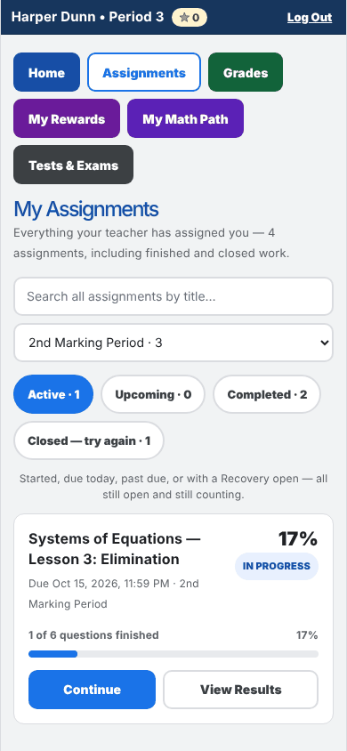
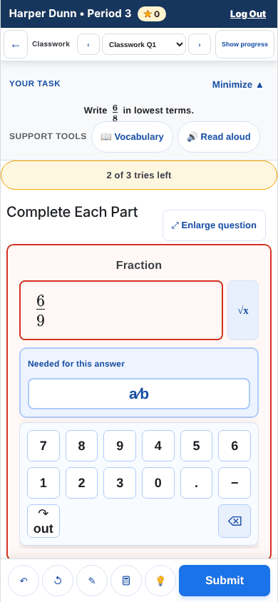
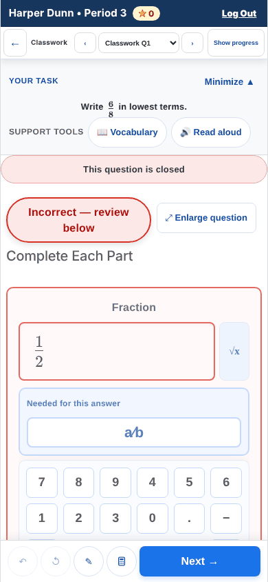
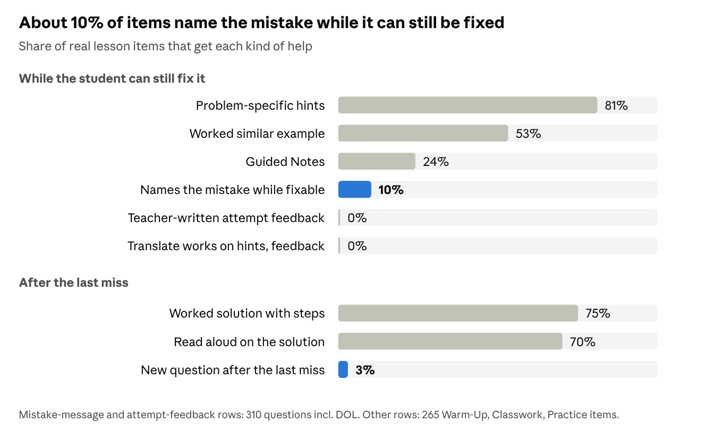
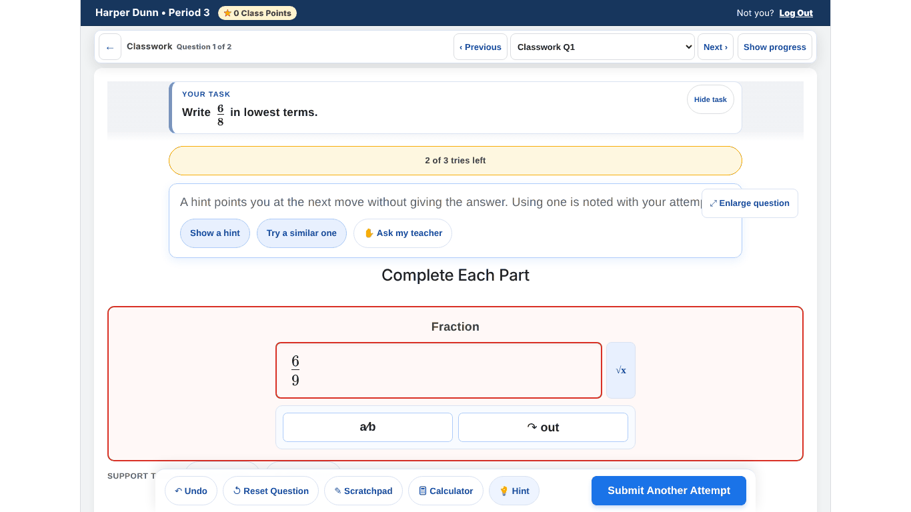
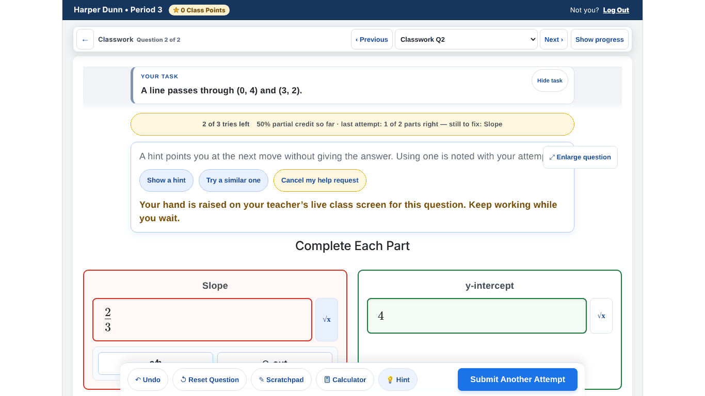
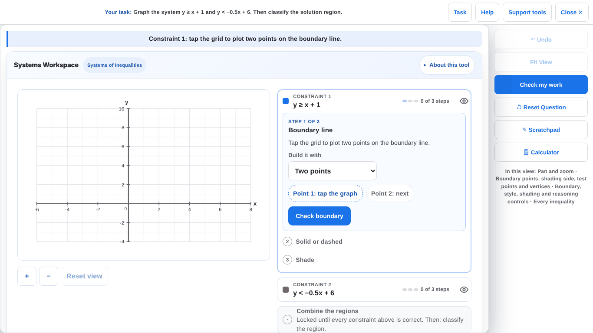
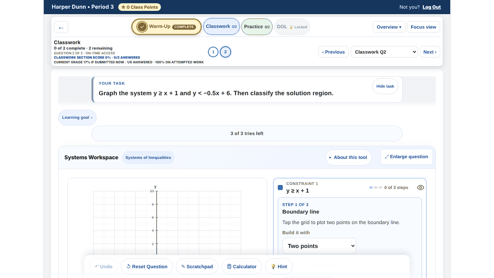

# MathMaster Student Experience — Pass 3 Findings & Decisions

2026-10-16 · main at `25250b4` · the editable copy with decision dropdowns is the Claude doc this file was exported from.

## At a glance

The basics are solid, but the moment that matters most for self-correction — right after a wrong answer — is broken on phones and thin everywhere else. The basics: one "Do this next" card, real addresses that survive refresh, autosave, progressive hints, and an excellent Work View.

**Fix these first:**

1. **On a phone, feedback and the worked solution after Submit cannot be reached** (RUN-1, P0, checked live). On a Chromebook they land under the sticky action bar.
2. **Correct answers are marked wrong:** "8,050" with a thousands comma (P0), equivalent function rules such as g(n)=2n, and −1/2(x−6) typed as a fraction.
3. **Mistakes are named too late.** About 90% of items say only "Not quite… Focus on: …" while the student can still fix the answer; the specific message waits until the item locks. After the last miss, only 3% of items can offer a new question.
4. **Help that never arrives.** Translate fails on every hint, feedback and solution; "Ask my teacher" reaches no one outside class; Read aloud skips the answer choices.
5. **Screen-reader and keyboard students lose their place.** Screen changes are silent, tool results are never announced, classroom math boxes are unnamed, and self-disabling buttons throw focus to the top of the page.

| Area | P0 | P1 | P2 | Polish |
| --- | --- | --- | --- | --- |
| Getting around | 0 | 3 | 12 | 8 |
| Inside an assignment | 1 | 6 | 9 | 5 |
| Help and self-correction | 0 | 6 | 15 | 4 |
| Rich tools and accessibility | 0 | 8 | 12 | 8 |
| Suggested before, still open (the 23 that matter most of 210) | 1 | 11 | 11 | — |

Eight build batches and ten policy calls are under Decisions. The first two batches, six to eight days together, remove both P0s. Policy calls D1–D3 decide how far batches 2 and 4 go.

## Scope and method

- **Scope:** everything a student uses except the learning paths (My Math Path and the weekly path): Home, Assignments, Grades, results, Tests & Exams, Rewards, Live Challenge entry, the assignment workspace, help and self-correction, and the rich tools.
- **Live walkthrough:** the real app in the repo's in-memory harness (no Firebase, no real students), signed in as a synthetic Period 3 student at Chromebook (1366×768) and phone (390×844) sizes, plus an automated axe scan.
- **Code audit:** four parallel reviews — navigation, the assignment runtime, help and self-correction, tools and accessibility. Each finding names the file and line it was checked in.
- **History sweep:** open items from the student push handoffs (A–Q), the QA passes and walkthroughs, the backlog, and PR reviews, each re-checked against main at 25250b4 (#495).
- **How to read the tables:** P0 loses work or blocks learning · P1 major confusion or an accessibility barrier · P2 moderate friction · P3 polish. Effort: S ≤ half a day · M ≤ 2 days · L > 2 days.

## Getting around: Home, Assignments, Grades, results

Home's single "Do this next" card works well. The gaps sit around it: screen changes are silent, blocked work hides its reason, and the big Grades number leaves out missing work.

| # | What a student runs into | Where in the code | Sev | Effort | Suggested fix |
| --- | --- | --- | --- | --- | --- |
| NAV-1 | Review My Work says "could not be loaded — Try again" for days when the real reason is "opens once the whole class has closed" (IEP extra time, feedback held, archived). | ReviewMyWork.jsx:136–162 · functions/lib/reviewMyWork.js:505–544 | P1 | S | Show the server's reason for refusals; keep "Try again" for network errors only. |
| NAV-2 | The big Grades number skips missing work. The only warning is a small "3 missing" chip and a line inside a collapsed panel, while Classroom may post zeros. | studentGradeCenterModel.js:274–282 · StudentGradeCenter.jsx:95–110 | P1 | S–M | Put "3 missing — your Classroom grade may be lower" under the number and link the chip to those rows. Policy choice in Decisions. |
| NAV-3 | Changing screens is silent. After Enter on "Grades", focus sits on the page body and nothing is announced (checked live). | StudentGlobalNav.jsx:84–111 · App.jsx:10315–10345 | P1 | M | After each screen change, focus the screen's heading and announce its title. |
| NAV-4 | A paused or archived lesson vanishes from Home without a word, but Grades ("MISSING · Start"), Ways to raise and Classroom links still open it. | studentDashboardModel.js:207–213 · waysToRaiseModel.js:69–78 · App.jsx:5594–5650 | P2 | S | One paused check before opening; land on the result page with "Your teacher paused this — your work is saved." |
| NAV-5 | On a phone the assignment screen hides every status line: late deadline, "no credit", "Live Challenge has started — Join". | App.jsx:9806–9826 · MathToolMobileLayout.css:440, 624–629 | P2 | M | One compact status chip in the phone's top bar. |
| NAV-6 | "What changed" sits below every assignment on Home and marks itself read on load, so nothing shows as new next time. | StudentDashboardView.jsx:545 · App.jsx:1920 | P2 | S | A "2 updates →" line under Do this next; mark items seen when they scroll into view. |
| NAV-7 | Home's "What changed" can print "Reason: Unauthorized assistance / cheating" on the screen most likely read over a shoulder. | WhatChangedList.jsx:70–74 · whatChangedModel.js:117–122 | P2 | S | Keep reasons off Home; show them on Grades and the result page. |
| NAV-8 | "Try it again — no credit" on the result page opens My Math Path skill practice. The same words elsewhere reopen the assignment. | StudentAssignmentResult.jsx:333–337 · App.jsx:11052–11076 | P2 | S | Two buttons: "Try these questions again" and "Practice this skill". |
| NAV-9 | Back buttons disagree with the browser: the result page says "← Assignments" after coming from Home; Test Cycle's Back always goes to Assignments; browser Back into a test card shows Home under a /test-cycle address. | App.jsx:10949, 5886–5900 · browserHistory.js:87–111 | P2 | S | Remember where the student came from, name each Back by its destination, restore the test on Back. |
| NAV-10 | Blocked starts ("finish the prerequisite first", "not open yet", "excused") appear only as a 5-second toast that does not pause on hover or focus. | Toast.jsx:20, 55–62 · App.jsx:5627–5643 | P2 | S–M | Send blocked starts to the result page's "what opens when" panel; let toasts pause. |
| NAV-11 | Raw error words reach students ("internal", "check the Firebase Functions log", "stale Hosting cache"); a Classroom link that cannot open waits on Home in silence. | authService.js:397–409 · TestCycleCard.jsx:187–259 · urlArrival.js:64 | P2 | S | One student-friendly error translator with a named way out (navigationModel.js already has an unused resolveErrorExit). |
| NAV-12 | The timed Do this next card ("Your exit ticket is open · 4:32 left") has no lesson title and shows tomorrow's due date for something closing in minutes. | studentDashboardModel.js:640–668 · WhatShouldIDoNow.jsx:96–130 | P2 | S | Add the title; say "Closes at 2:45 PM". |
| NAV-13 | On a phone, six nav buttons wrap to three rows (about 200px) above every screen; on Assignments about 550px of chrome comes before the first assignment. | StudentGlobalNav.jsx:77–111 · StudentAssignmentsCenter.jsx:200–289 | P2 | M | Phone: Home / Assignments / Grades plus More, or a bottom bar; fold the search away. |
| NAV-14 | "Lesson 3 was reopened" leads to a result page saying the grade "can no longer change". | whatChangedModel.js:249 | P2 | S | Decide what "reopened" means; list only real extensions until then. |
| NAV-15 | No main landmark on Home, Assignments, Grades, Rewards or Live (axe); Test Cycle and Live have no top heading; Grades period headers are buttons, not headings. | App.jsx:10343 (skip target is an empty div) · TestCycleCard.jsx:382 | P2 | S | Wrap each screen in a main region with an h1; put disclosure buttons inside headings. |

**Polish (P3):**

- Names drift: "Exit ticket" vs "DOL" (never spelled out); closed work is "Closed", "Closed — try again", "Practice only" or "Practice Mode"; "See results" vs "View Results"; "Back to Dashboard" vs "Home".
- Teacher words on student screens: "Regular due / Final late due", "Your grade · frozen", "your evidence, your mastery", "PERSONALIZED VERSIONS", "On-time access", "Retention concern" in red, "No assignments have been given to 1 yet".
- Raw dates and missing times: "DOL opens in class on 2026-10-21"; a test "opens at the scheduled time" when the time is known.
- Duplicate controls: nav Home plus "← Home" on Grades and Tests; two Back buttons in the assignment header, one a 15px-tall text link; "Export PDF" on every Home card.
- Assignments forgets its search, tab and marking period after View Results → Back.
- A Classroom DOL link tapped before the DOL opens lands on Classwork with no message.
- The 5-minute pack-up banner covers the assignment's top navigation and says "Save your work" though work saves itself.
- The Live Challenge lobby shows only on Home; leaving a Warm-Up game returns to Home, not the assignment.

**Working well:** one "what can I do now" rule drives Home, Assignments, Grades and results, so no Start button leads nowhere. Every screen has a real address that survives refresh, and Back never shows the previous student's screens on a shared Chromebook. Grades never invents zeros, and Log Out asks first only when work is unsent.

## Inside an assignment

On a phone, students never see what happens after they submit. The "Not quite" message, the hint offer and the worked solution all render below a screen that cannot scroll. On a Chromebook they land under the sticky action bar.

| Phone, after a wrong answer: only the tries strip turns amber | Phone, after the final try: "review below" points at a solution no one can reach |
| --- | --- |
|  |  |

| # | What a student runs into | Where in the code | Sev | Effort | Suggested fix |
| --- | --- | --- | --- | --- | --- |
| RUN-1 | After Submit on a phone, the result cannot be reached. Measured live at 390×844: the message sits at y=869 with 0px visible and the page will not scroll. After the final try, the worked solution sits at y=1244. On a 1366×768 Chromebook the message lands under the sticky action bar. | QuestionEngine.jsx:2553–2699 (renders after the question container) · MathToolMobileLayout.css:49–54, 680–686 · App.css:988–1004 | **P0** | M | Render the outcome and the closed review inside the workspace, above the action bar, and scroll it into view. Add a phone "can reach the feedback" browser test. |
| RUN-2 | Step Algebra at the default Standard level charges a try for a valid but longer move. On a one-try DOL, adding 7 to both sides of 3x+6=21 ends the question; three mis-taps while marking a cancellation can close a Classwork item. | functions/shared/algebra/algebraSupportLevels.mjs:63–71, 146 · StepByStepAlgebraCore.jsx:1320–1335, 1529–1571 | P1 | S–M | Valid moves and tap slips should never spend the question's tries. Policy choice in Decisions. |
| RUN-3 | If the device cannot queue an answer, the screen still shows "Correct!", locks the question and says "Saved on this device only"; the toast says to press Submit again, but Submit is gone. (Code path; the storage failure was not reproduced.) | App.jsx:6911–6915, 10264 · QuestionEngine.jsx:676–681, 1071–1085 | P1 | S | Treat a failed queue as "not submitted": keep Submit and say so plainly. |
| RUN-4 | The button that spends a try has many names ("Submit Answer", "Submit Another Attempt", "Check construction"), while "Check this stage" is free. The last try looks like any other, and multiple choice quietly gets one try in a 3-try section. | QuestionEngine.jsx:2007–2017, 2205 · attemptPolicy.mjs:40–59, 98 | P1 | M | One verb that shows its cost ("Check — uses 1 of 3 tries"), a distinct final-try state, and "Multiple choice: one try". |
| RUN-5 | A quiz with feedback held still shows right and wrong: question numbers turn green or amber (announced as "correct" / "needs another try") and the tab shows ✓ Complete only when all are right. | App.jsx:9937–9940, 10026–10046 (the overview grid already masks this at 10101–10117) | P1 | S | Apply the overview's mask to the numbers and tabs. |
| RUN-6 | The final miss shows five "closed" messages in mixed words, and the big "Next Question — press Enter" card comes before the worked solution, so the solution is easy to skip. | QuestionEngine.jsx:2636–2668 (continue card) before 2680–2699 (closed review) | P1 | S | One closed card: your answer beside the correct one, the worked solution, then one next action. |
| RUN-7 | The work gets little room. At 1366×768, sticky chrome ends at y=301, leaving 277px (36%); at 390×844, 373px (44%). The navigator carries four lines of grade text. "Focus view" scrolls the page to the top: the Systems graph moved from 491px to 619px down. The mode that works, Work View, is labelled "Enlarge question". | App.jsx:864–889, 9980–9989, 9995–10023 | P1 | M | Compact navigator by default on every size; move grade lines into Overview; call it "Work View" everywhere and make Focus view keep the work in view. |
| RUN-8 | Locked and closed sections do not say why or when. The DOL tab is a disabled button whose reason lives only in a hover tooltip; its opening time appears only on the results page. A teacher-closed Classwork cannot be revisited, though the message promises saved work stays visible. | App.jsx:9563–9577, 9925–9944, 10123–10127 | P2 | M | Keep closed sections viewable read-only, labelled "Opens 10:42" or "Closed by your teacher". |
| RUN-9 | Out-of-tries questions read "needs another try"; a closed Warm-Up's overview still says "2 tries left". | App.jsx:10027–10032 · attemptPolicy.mjs:622–629 | P2 | S | A third "closed" state everywhere. |
| RUN-10 | Timers end without warning, secure tests included. The phone pill ticks once a minute and reads "DOL open · 0m" in the last minute. A half-filled answer is not submitted, and nobody says so. | App.jsx:9826, 10075–10077 · ExamPrepHeader.jsx:80–87 | P2 | M | Announced alerts at 2:00 and 0:30, and a plain line: unfinished answers are not submitted. |
| RUN-11 | The save line reports navigation, not answers: moving between questions shows "Syncing · 1 change" and then "Recorded by MathMaster" beside an unsubmitted draft. | App.jsx:5385–5413, 10258–10261 · saveStatusModel.js:28–34 | P2 | S | Separate "Draft saved" from "Answer recorded". |
| RUN-12 | Finishing skips the lesson summary: the last button is "Continue to \<next lesson> →". A section that ends on a miss gets no complete card. A skipped earlier question leaves no Next button at all. | assignmentHandoff.js:15–29 · QuestionEngine.jsx:2604, 2063–2069 · App.jsx:9592–9599 | P2 | S | Land on the results page with Up next as the second action; offer "Go back to Q1 (not answered)". |
| RUN-13 | "Start this question fresh" cannot be pressed on a closed question, the very case it was built for. | QuestionEngine.jsx:2452–2478 | P2 | S | Render it outside the disabled area. |
| RUN-14 | During a Warm-Up on a phone, a 140px "WARM-UP ACTIVE" banner covers the top of the task card and a toast sits over the Submit bar for several seconds (checked live). | App.jsx:8692–8789 | P2 | S | Put the countdown in the section pill on phones; skip the duplicate toast. |
| RUN-15 | Phone navigator: 8–10px text, 25px question buttons, 23×34px Prev/Next arrows, and the DOL tab clipped under Focus view. | App.css:1486–1495, 1576–1588 | P2 | S | Larger compact row: section, "Q2 of 6", Prev/Next at 44px. |
| RUN-16 | Program words in the runtime: "on this version", "ON-TIME ACCESS", "PERSONALIZED VERSIONS", "Current grade 17% if submitted now" (there is no assignment submit), "Productive struggle scaffold" (screen-reader name), "Details for your teacher: \<error>"; "Complete Each Part" over a single box. | App.jsx:9499, 9860, 10019 · QuestionEngine.jsx:1650, 2490 · QuestionModuleBoundary.jsx:151 | P2 | S | Student copy pass (see the shared word list in Decisions). |

**Polish (P3):** secure tests show "1 of 1 try left" on tool items although saving costs nothing; two different controls are both called "Support tools" on one phone screen; up to five live regions announce one correct answer; section tabs jump to out-of-tries questions instead of the next workable one; the math keypad stays open on a closed question.

**Working well:** a second tab pauses the first with "Continue here"; answers queue on the device and are never called submitted before the server has them; refresh returns to the same question; Reset asks first and keeps attempt history; the section milestone card ("Classwork complete — Continue to Practice") is clear; secure tests support skip, flag, review before submit and a pause that stops the clock.

## Help and self-correction

The help pieces are good where they exist: progressive hints, a worked "similar one" with different numbers, and a worked solution. The trouble is timing. During attempts the feedback is generic, and after the last miss most items leave nothing to practise.

_Node probe of the 16 lesson files in the repo, compiled at 25250b4 (310 questions) · 2026-10-16._

Help is plentiful before a first try and after the last one; the gap is the moment a student is fixing a mistake.

| The help panel: text runs under "Enlarge question" | "Ask my teacher" raises a hand only on a live class screen |
| --- | --- |
|  |  |

| # | What a student runs into | Where in the code | Sev | Effort | Suggested fix |
| --- | --- | --- | --- | --- | --- |
| HELP-1 | After the last miss almost every Classwork or Practice item is a dead end: no new question (only 8 of 265 real items can make one), no Recovery (Warm-Up and DOL only), and "Try a similar one" disappears. | App.jsx:7088, 9438–9445 · recoveryStates.js:15–16 · QuestionEngine.jsx:1504 | P1 | L | On every closed item, offer an unscored "practise one like this" from its question family. Whether Classwork and Practice can earn credit back is a Decision. |
| HELP-2 | Feedback during attempts is generic on about 90% of items. Live: a sign slip (2/3 for −2/3) and a reciprocal (−3/2) both get "Not quite… Focus on: Slope". The specific message ("right size but opposite sign") is held until the item locks. 0 of 310 real items author attempt feedback. | genericMissChecks.js:82–85 · attemptFeedbackPlan.js | P1 | M | Offer the diagnosis as an opt-in hint rung, "What might have gone wrong?", recorded like any hint. Pre-Flight warns when practice items have no attempt feedback. |
| HELP-3 | Translate on feedback, hints, worked examples and solutions always answers "A translation is not available for this text yet." The Spanish pack covers prompt directions only, and the failure is never recorded. | SupportedText.jsx:51–89 · language pack es.js | P1 | M | Add the fixed platform sentences to the Spanish pack; hide Translate where it cannot work; record "unavailable" for the support report. |
| HELP-4 | In Recovery practice, a hint or worked example quietly stops that item counting toward the unlock, while the screen says "Correct! Nice work." | SectionRecoveryRunner.jsx:62–65, 436 · practiceMastery.mjs:61–67 | P1 | S | Say so on the hint button, or release hints only after an answer. |
| HELP-5 | "Ask my teacher" never gets an answer. It is a flag on the live heartbeat: at home nobody sees it, a reload quietly lowers the hand, and the teacher's monitor has no way to reply. | helpRequest.js:18–27 · App.jsx:1793, 10235 · LiveClassMonitor.jsx:75 | P1 | M | A teacher "seen / on my way" the student can see; outside class, "leave a question for my teacher" answered in Review My Work. |
| HELP-6 | Read aloud reads the prompt only: not the answer choices, field labels, the current step, Guided Notes, the "Let's back up" question or "Information you need". | SupportToolsTray.jsx:229–233 · QuestionEngine.jsx:380–383 | P1 | M | One "read this question" text that covers all of it. |
| HELP-7 | On math tools (42% of items) the "hint is ready" offer and the Read and Translate buttons on the miss message never appear. | QuestionEngine.jsx:1664–1674, 2571–2593 · ToolShell.jsx:296–340 | P2 | S | Pass the hint action and Read/Translate into the in-tool outcome. |
| HELP-8 | Feedback vanishes at the first keystroke, so a student fixing their answer loses the message and red borders. Inclusion students never see the "still to fix" line. | QuestionEngine.jsx:663–668, 2181 · studentSupport.js:106 | P2 | S | Keep the last miss visible, dimmed, until the next submit. |
| HELP-9 | "Try a similar one" (available on 141 of 265 items) sits only inside the hint panel and is gone after the item closes. | HintPanel.jsx:68–70 · QuestionEngine.jsx:2588–2593 | P2 | S | Offer it right after a miss and under the worked solution. |
| HELP-10 | Tool questions have two hint ladders with different rules. In Graphing, three taps on "Stuck? Show a hint" reveal "Plot (0, 3) and (2, 3)" without a single attempt. | ToolShell.jsx:473–519 · Graphing2.jsx:112–171 · questionHints.js:84–107 | P2 | S–M | One hint ladder per question, with the platform's release rule and leak check. |
| HELP-11 | The worked solution is often just the answers (60 of 265 have no steps; 79 have no Read aloud). It sits inside the red error box and never shows what the student wrote. | closedQuestionReview.js:119–122 · QuestionEngine.jsx:2682–2689 | P2 | M | Per-part "You wrote / Correct" rows, Read aloud on every review, a neutral panel. |
| HELP-12 | Review My Work uses the oldest solution view: no right/wrong flag, no Read or Translate; 95 of 180 non-tool items lose their worked steps there. | ReviewMyWork.jsx:94 | P2 | S | Use the same solution panel the question uses. |
| HELP-13 | Test Cycle Corrections say "a specific mistake pattern" but never name it, answer "Not yet. Look again…", and ask for no reflection. | testCycleDiscovery.js:297–300 · functions/index.js:19384–19402 | P2 | S–M | Name the diagnosed mistake (the student message exists) and add a one-question reflection per skill. |
| HELP-14 | The lesson compiler drops teacher-written per-answer feedback (`misconceptions`), so it never reaches students. | authoringIntentV5Core.js:156–160 (copyCommon) | P2 | S | Add the field to copyCommon. |
| HELP-15 | Mistake messages for Graphing Lines and Relationship Model never reach the screen: the server records "slope-intercept-swapped", the student sees "Not quite". | QuestionEngine.jsx:1086–1090 · misconceptionClassifiers.mjs:842–851 | P2 | S | Pass the fields the classifier needs into on-screen grading. |
| HELP-16 | The answer-leak filter silently drops 32 of 200 teacher-written hints, many harmless ("Solve 0 = 3x − 8" is dropped because 3 answers another part). | questionHints.js:84–90 | P2 | S | Show dropped hints in Pre-Flight; ignore numbers already in the prompt. |
| HELP-17 | Students are never told hints do not cost points ("Noted with your attempt", "Recorded for your teacher"). | HintPanel.jsx:55–57 · ToolShell.jsx:501, 510 | P2 | S | One honest sentence everywhere: "Hints never lower your score." |
| HELP-18 | Choice-only items (50 of 265) get one try, no hint offer and no reason: one wrong tap locks the item and shows the answer. | attemptPolicy.mjs:97 · missDiagnosis.js:115–121 | P2 | S | Say "one try" up front; after it, a one-line reason per option. |
| HELP-19 | The inclusion "Let's back up" step is generic on 113 of 265 items, covers the work with a Yes/No, and is announced as "Productive struggle scaffold". | backUpStep.js:42 · QuestionEngine.jsx:2490–2496 | P2 | S | Show it only where a step written for that problem exists; rename the region. |
| HELP-20 | Recovery practice shows "3 of 3 tries left" but takes one answer; Guided Notes exist on 64 of 265 items and are off by default in Practice. | SectionRecoveryRunner.jsx:293, 324–334 · guidedNotes.js:93–146 · App.jsx:9547–9548 | P2 | S–M | Show the real count; decide Guided Notes defaults for Practice. |
| HELP-21 | On a Chromebook the help panel's first line runs under the "Enlarge question" button, and opening a hint plus the similar example pushes the answer box to y≈916 of 768. | live walkthrough | P2 | S | Anchor Enlarge to the tool header; fold the earlier hint when the example opens. |

**Polish (P3):** fallback hints that do not fit their items ("Underline…", "keep the two sides equal" on 50 items, 20 of them three-variable systems); misleading lines such as "You may submit the same response again. No answer change is required." right after a miss; "Check my points" gives the exact correction ("2 units below the function") with unlimited presses in 11px text; "tries" and "attempts" used interchangeably.

**Working well:** one rule keeps DOLs, quizzes and tests free of help that would give answers away; hint and example leak checks are real and tested; question families supply problem-specific hints, a worked example and a worked solution for every generated type; the misconception messages never blame the student; using help never lowers a grade.

## Rich tools and accessibility

The shared controls are consistent: one work bar with the same Undo, Reset, Scratchpad, Calculator and Hint on every question, and Work View is excellent on a Chromebook. The gaps are inside the tools: results a screen reader never hears, focus that jumps to the top of the page, and ten tools without Undo.

| Work View on a Chromebook: the whole tool fits | The same question on load: the graph is cut off by the action bar |
| --- | --- |
|  |  |

| # | What a student runs into | Where in the code | Sev | Effort | Suggested fix |
| --- | --- | --- | --- | --- | --- |
| A11Y-1 | A screen-reader student hears that a Check failed, not why: the tool's coaching ("Point P1 is on the line, but the other one is not…") is never announced. Plotting a point with Enter gives no confirmation. 14 of 24 tools announce only the tries sentence. | ToolShell.jsx:296–386 · Graphing2.jsx:433–438 · CoordinatePlane.jsx:458–476, 548–552 | P1 | M | One shared live result region for tools; announce "Plotted (3, −2). 2 of 2 points." |
| A11Y-2 | Buttons that disable or remove themselves throw keyboard focus to the top of the page. In Open Sort a 12-card sort means 12 trips back from the top. | OpenSortBoard.jsx:195–212, 260 · Graphing2.jsx:428 · StepAlgebra2.jsx:222 · RegressionCalculator.jsx:449, 491 | P1 | S–M | Apply the existing useFocusSafeDisabled hook (used only by Universal Undo today); move focus to the next card after a placement. |
| A11Y-3 | Classroom math answer boxes have no name where a screen reader lands (MathLive's inner field); axe flags it live. Only the secure-exam field fixes this. | MathInput.jsx:572 vs SecureMathAnswerField.jsx:85–100 | P1 | S | Reuse the secure field's naming in MathInput. |
| A11Y-4 | Read aloud now says `7 dollars $ units` for the prompt text `$7$ units` (218 such spans, tests and Live Challenge solutions included); "c(x)" is read "c times the quantity x"; matrices are never read. | mathSafeText.js:129–134 (from today's #495 merge) · #491 R-5, #495 R-6 | P1 | S | Treat a closed dollar-delimited math span as math before the price rule; add function-name and matrix speech. |
| A11Y-5 | Algebra tokens and buttons read program syntax: "Pick up the expression ((12-3x)/(2))", "\[A\]⁻¹·\[B\]". Voice-control students cannot say what they see. | AlgebraicSystemMode.jsx:116, 134, 193 · StepByStepAlgebraCore.jsx:2007, 2032 · MatrixCalculator.jsx:63–65 | P1 | S | Pass labels through the existing spokenMathLabel(). |
| TOOL-1 | A function-graph question cannot be finished without a mouse or finger: after keyboard points, the curve must be drawn by hand. | InteractiveGraphWorkspace.jsx:793–866, 904–1000, 1368 | P1 | M | A "Connect my points" button (the grader already checks a curve through the student's own points). |
| TOOL-2 | Ten tools have no Universal Undo. Open Sort's "Remove group" deletes the typed name and rationale with no confirmation and a greyed-out Undo. Inverse Derivation shows two Undo buttons; the work-bar one never works. | OpenSortBoard.jsx:136–140, 261 · workViewInventory.js:5–28 · QuestionEngine.jsx:2082 | P1 | M | Add the documented ten-line undo hook to each tool, card sorts first. |
| TOOL-3 | On a phone in Work View, Help says "Use the directions and controls in this workspace…", but the directions and "Ask my teacher" are hidden there. | WorkViewShell.css:246, 371 · RegisteredToolWorkView.jsx:63–65 · workViewCapabilities.js:31–45 | P1 | S–M | Work View Help = the tool's steps, then the platform hints with Ask, then the tool's own hints. |
| A11Y-6 | Dark mode hides point labels on every coordinate plane (#24324a on #171a20, about 1.35:1) and the 3D model's axes; the dark-mode certification covers 3 tools with no points plotted. | CoordinatePlane.jsx:806–807 · ThreePlaneWorkspace.jsx:420, 466 · darkModeCertification.mjs:66 | P2 | S | Use the graph colour tokens; add plotted-point scenes to the certification. |
| A11Y-7 | Contrast found live by axe: the section tab's "COMPLETE" badge is 9px white on #a66b00 (4.44:1, below 4.5:1); the math placeholder is 1.66:1. The repo's ratchet never renders a completed section. | App.jsx:9939 (tab badge) · MathInput placeholder | P2 | S | Darker badge token; add a completed-section scene to the accessibility certification. |
| TOOL-4 | "Check" sometimes costs a try and sometimes not (Representation Bridge's "Check this stage" is free, its final Check is not); seven different reset words; developer words like "Numeric controls · Table data" and "token form". | RepresentationBridge.jsx:283–328 · useToolSubmission.js:8–13 · RegisteredToolWorkView.jsx:11–15 | P2 | S–M | "Check" never costs a try; "Submit" always does and says so; one reset word. |
| TOOL-5 | Tool feedback does not say what to change: Function Operations says "Some parts are correct…" even when none are; Regression says "setup is incomplete or invalid"; the calculator shows a bare "Error". | FunctionOperationsLab.jsx:150–155 · RegressionCalculator.jsx:371–381 · CalculatorPanel.jsx:152, 318 | P2 | M | Name the failing part, as Matrix Lab's "Reconsider:" list already does. |
| TOOL-6 | Selection shown by border colour only (Representation Match, Number Line); ten radio groups have no arrow keys; errors marked by colour alone in tables and graphs. | RepresentationMatch.jsx:240, 364–388 · TableGrader.jsx:97–110 · IntervalNumberLine.jsx:640–681 | P2 | S | One shared choice group on radioGroupKeys.js; a visible "✗ check this" plus aria-invalid. |
| TOOL-7 | Step Algebra's history is read as "Before: Subtracted 3 from both sides. After: Subtracted 3 from both sides." The equations are never spoken. | AlgebraWorkSteps.jsx:21, 35, 37 | P2 | S | Drop those labels and let the math display speak the equation. |
| TOOL-8 | Readouts show forms the platform bans elsewhere: "y = 0.66666667x + 2", "y = 1x + 0", "P(x) = 1x^2 -5x +6". | graphingMath.mjs:11, 164–169 · PolynomialWorkshop.jsx:21–27 | P2 | S | Exact-fraction formatter and the math display. |
| TOOL-9 | On a phone, graph tick numbers render at about 6–7px, the pick-up area is about 10px, and a missed drag plots a third point that silently restarts the line (calculated, not measured). | CoordinatePlane.jsx:105, 375, 671–686 · Graphing2.jsx:212–215 | P2 | M | Minimum on-screen text size, larger touch radius, no silent restart. |
| TOOL-10 | Calculator keys have no spoken names ("C", "xʸ", "a⁄b") and results are not announced; every math-keypad key is its own Tab stop. | CalculatorPanel.jsx:16–30, 556–587 · MathInput.jsx:710–730 (issues #383, #386) | P2 | S | Reuse the keypad's key names; announce "equals 3.75"; one Tab stop with arrow keys. |
| TOOL-11 | Open Sort's repeated buttons share one name ("Place selected card here", "Remove group"); Mapping Diagram arrows can only be reviewed by sight ("4 arrows drawn", one "Clear arrows"). | OpenSortBoard.jsx:260–266 · RelationMapping.jsx:394, 455–461 | P2 | S | Name the card and group in each button; a text list of arrows with Remove on each. |
| TOOL-12 | Regression Calculator has no how-to steps and its ＋/− zoom buttons are decoration; the "Information you need" card disappears in Work View. | RegressionCalculator.jsx:388–433 · QuestionEngine.jsx:1983, 2338, 2347 | P2 | S | Three how-to steps; working or removed zoom; a Reference drawer in the Work View header. |
| A11Y-8 | The VPAT is out of date: rows 1.4.3, 1.4.4, 1.4.12, 2.1.1, 2.4.3, 2.5.1 and 4.1.2 still list gaps that pushes H and N fixed, while 4.1.3 understates today's gaps. No testing with real screen readers has been done. | docs/accessibility/VPAT\_2.5\_WCAG\_MathMaster.md | P2 | S | Refresh it before a district sees it; schedule one NVDA and one VoiceOver pass. |

**Polish (P3):** on phones Undo (↶) and Reset (↺) are near-identical icons side by side; the "√x" button opens the math keypad but reads as "insert square root", and the "↷ out" key label is cryptic; Work View is announced "Question Work View, Work View"; only one tool opens Work View on its live work; a closed question cannot be enlarged for review; the Scratchpad slide-up ignores reduced motion; some 32–36px buttons override the 44px phone minimum; instructions say "Click the grid".

**Working well:** one work bar with the same tools, order and icons everywhere; Universal Undo is well built where tools use it; math is spoken in words; the coordinate plane supports keyboard plotting and press-slide-lift with a preview; large text is finished and protected by a test; every keyboard gap from the earlier sweep (T1–T8) is confirmed fixed.

## Suggested before, still not built

Of 325 earlier suggestions re-checked against today's code (some appear in more than one source), 210 are still open or partly done and 115 are done. Most open ones are P3 polish. The table lists those that matter most and are not already in the sections above.

| Sources | Rows re-checked | Open or partly done | Done since |
| --- | --- | --- | --- |
| Student push handoffs A–Q and support status docs | 121 | 79 | 42 |
| QA passes, walkthroughs, backlog, VPAT | 119 | 67 | 52 |
| PR bodies and review threads, #375–#495 (76 PRs read) | 85 | 64 | 21 |

| Item still open | Raised in | Sev | Effort |
| --- | --- | --- | --- |
| **Right answers marked wrong.** "8,050" with a thousands comma is graded wrong and costs a try; a key written "8,050" rejects 8050 (confirmed in the shared grader). Only Matrix Lab strips commas. | [#495](https://github.com/matthewhawkinsus1-crypto/mathmaster-platform/pull/495) walkthrough P0-1 · ordinaryResponseGrading.mjs:229, answerUtils.mjs:184 | **P0** | S–M |
| Equivalent function rules are refused in compiled workflows: g(n)=2n, 2x or y=2x when the key is f(x)=2x. | [#375](https://github.com/matthewhawkinsus1-crypto/mathmaster-platform/pull/375) review · authoringIntentV5Core.js:801–806 | P1 | S |
| Typing −1/2(x−6) silently becomes −1/(2(x−6)), so point-slope answers with a fraction slope change meaning. | [#491](https://github.com/matthewhawkinsus1-crypto/mathmaster-platform/pull/491) R-11 · typedFractionEntry.js:21–46 | P1 | M |
| On a live Test the boundary of x ≤ 5 is drawn dashed while the key expects solid; vertical lines are always dashed. | [#480](https://github.com/matthewhawkinsus1-crypto/mathmaster-platform/pull/480) · CoordinatePlane.jsx:689 | P1 | S |
| A right line in the wrong form gets no reason; Transformations Lab gives 20% for correct points plotted out of order without mentioning order; Matrix Lab refuses a correct simplified model without a reason. | [#491](https://github.com/matthewhawkinsus1-crypto/mathmaster-platform/pull/491) R-3, R-4 · [#495](https://github.com/matthewhawkinsus1-crypto/mathmaster-platform/pull/495) · matrixLabModel.mjs:282 | P1 | M |
| Planes are not equal-unit, so the lesson's "90° rotation" shows lines meeting at about 30°. | [#491](https://github.com/matthewhawkinsus1-crypto/mathmaster-platform/pull/491) R-1 · graphSpecUtils.js:295–348 | P1 | M |
| Exit tickets show each tool's "How to do this" method card (Matrix Lab's DOL 3 card states the decision rule), and the one graded submission is labelled "Check". | [#491](https://github.com/matthewhawkinsus1-crypto/mathmaster-platform/pull/491) R-10 · [#495](https://github.com/matthewhawkinsus1-crypto/mathmaster-platform/pull/495) R-9 · issues [#383](https://github.com/matthewhawkinsus1-crypto/mathmaster-platform/issues/383), [#386](https://github.com/matthewhawkinsus1-crypto/mathmaster-platform/issues/386) · ToolShell.jsx:396–420 | P1 | S |
| **Work that can be lost.** A refused device pin is never replaced, so a question can change under the student and drop in-progress work. | [#430](https://github.com/matthewhawkinsus1-crypto/mathmaster-platform/pull/430) review · familyDelivery.js:64–75 | P1 | S |
| On a fresh Chromebook one early touch can overwrite saved multi-answer, Step Algebra and composed answers; two devices editing different steps can lose one. | [#458](https://github.com/matthewhawkinsus1-crypto/mathmaster-platform/pull/458) · the fresh-device merge covers tool workspaces only | P1 | M |
| Saves fail silently when storage is full, the backup refuses a record, or past 120 drafts; stale fields from an older attempt can merge into a new one. | [#458](https://github.com/matthewhawkinsus1-crypto/mathmaster-platform/pull/458) · questionDraftStorage.js:335, 361, 393 · App.jsx:3831 | P2 | S–M |
| **Tests and accommodations.** An A2.3B matrix item cannot be stored as a secure Test or Corrections item (Firestore rejects the nested array). It becomes P0 the first time such a Test runs. | [#446](https://github.com/matthewhawkinsus1-crypto/mathmaster-platform/pull/446) review · functions/lib/secureItemStorage.js:39 | P1 | S |
| Extra time does not extend a student's DOL or Warm-Up window; secure exams already apply it. | IEP support status · assignmentLifecycle.js:629, sectionDeadline.mjs:396 | P1 | M |
| Screen readers get no description of number lines, mapping diagrams, the 3D planes or statistics charts; only the coordinate plane has one. | QA platform pass · platform quirks audit | P1 | M |
| A timed-out test the student walked away from stays "in progress", holding their results and the class's released solutions until a teacher acts. | Push B · [#461](https://github.com/matthewhawkinsus1-crypto/mathmaster-platform/pull/461) · functions/index.js:16986 | P2 | M |
| Classroom shows a returned grade at the class's final cutoff while a student is still on extended time. | Push I · functions/index.js:3370–3373 | P2 | S |
| Secure tests: ordered pairs, inequalities and π, √, %, $ answers are plain text boxes; Vocabulary is removed on tool questions; released worked solutions have no Read aloud or Translate. | Push B, J · secureAnswerEntry.js:49, 118 · RichQuestionRuntime.jsx:221–232 · SecureExamReview.jsx:296 | P2 | M |
| 1,285 closed questions show only the answer, no steps: 832 secure DOL 2 retest items and 336 DOL 2 review tasks. | Push O | P2 | L |
| The Test Cycle card shows the class late date, not the student's extension; a Test day set after its period ended marks the whole class missed and moves them to a Retest. | [#480](https://github.com/matthewhawkinsus1-crypto/mathmaster-platform/pull/480) · [#477](https://github.com/matthewhawkinsus1-crypto/mathmaster-platform/pull/477) · testCycleAvailability.mjs:258–266, 366–368 | P2 | S–M |
| **Tools.** Matrix Lab: one mistake gives five "Reconsider" lines; the figure sort does not say which figures are wrong; hints often state the key rows; a bare "-" or an untouched pre-filled cell costs a try; a singular system can be passed on a second guess. | [#495](https://github.com/matthewhawkinsus1-crypto/mathmaster-platform/pull/495) walkthrough P2 list | P2 | M |
| 3×3 elimination strands the student when a variable is missing from an equation; the inequality vertices step shows "done" after only some vertices; 3×3 substitution keeps a fixed 220–280px column while solving. | [#391](https://github.com/matthewhawkinsus1-crypto/mathmaster-platform/pull/391) · [#444](https://github.com/matthewhawkinsus1-crypto/mathmaster-platform/pull/444) · Sept 24 UX QA | P2 | M |
| An assignment's calculator setting (for example "graphing") is saved but never read; a graphing calculator exists only inside secure exams. | open PR [#239](https://github.com/matthewhawkinsus1-crypto/mathmaster-platform/pull/239) · issue [#383](https://github.com/matthewhawkinsus1-crypto/mathmaster-platform/issues/383) · App.jsx:7218 | P2 | M |
| Step Algebra shows teacher wording ("Support 3 · Standard", "Nothing is simplified for the student"); after ÷ −2 the right side shows −(10/−2); "−2 x" spacing. | Sept 24 UX QA · StepByStepAlgebraCore.jsx:2296, 2847 · algebraAstEngine.mjs:442–476 | P2 | S |
| A Live Challenge round never closes if no teacher console or projector is open; a student added mid-game is not invited. | Backlog · functions/index.js:23901 | P2 | M |

**Housekeeping on GitHub:** land the calculator-setting half of [#239](https://github.com/matthewhawkinsus1-crypto/mathmaster-platform/pull/239) (its Work View half is already on main); [#445](https://github.com/matthewhawkinsus1-crypto/mathmaster-platform/pull/445) holds back the DOL 2 retest content; issues [#217](https://github.com/matthewhawkinsus1-crypto/mathmaster-platform/issues/217) and [#202](https://github.com/matthewhawkinsus1-crypto/mathmaster-platform/issues/202) are already built and can be closed, as can the answered issues #221, #359, #361–#364, #369, #371, #376, #378, #380 and #385; PRs [#4](https://github.com/matthewhawkinsus1-crypto/mathmaster-platform/pull/4) and [#172](https://github.com/matthewhawkinsus1-crypto/mathmaster-platform/pull/172) look superseded and [#349](https://github.com/matthewhawkinsus1-crypto/mathmaster-platform/pull/349) is stale.

## Recommended batches and your decisions

Start with what every student meets on every wrong answer: make the result visible, then make sure right answers count. On 2026-10-16 the call was to go with every recommendation below and start Batches 1 and 2; the policy calls below unblock batches 2, 4 and 5.

| Order | Batch | What it fixes | Effort | Decision |
| --- | --- | --- | --- | --- |
| 1 | **See the result.** Every student sees and hears what happened after Submit, on a phone too: outcome and worked solution inside the workspace, one closed card with "You wrote / Correct" before Next, feedback that stays until the next submit, the hint offer on tool questions, a shared live result region. | RUN-1, RUN-6, HELP-7, HELP-8, HELP-21, A11Y-1 | 3–4 days | Built — see [the handoff](../handoffs/STUDENT_PASS3_BATCH1_2.md) |
| 2 | **Right answers count.** Thousands commas, equivalent function rules, −1/2(x−6) entry, solid vertical boundaries, no tries spent on valid Step Algebra moves (D1), the matrix secure-storage fix, teacher feedback the compiler drops, classifier messages that never reach the screen. | Suggested-before rows 1–4 and the A2.3B row · RUN-2 · HELP-14 · HELP-15 | 3–4 days | Built — see [the handoff](../handoffs/STUDENT_PASS3_BATCH1_2.md) |
| 3 | **Never lose work.** Device pins that get replaced, the fresh-Chromebook overwrite, saves that fail silently, a failed queue that still shows a verdict, and a finalizer for abandoned timed tests. | Suggested-before "work that can be lost" rows · RUN-3 | 4–5 days | On their own branches, to ship alone: the abandoned-test finalizer is built (`claude/pass3-b3-abandoned-test-finalizer`; its handoff, `docs/handoffs/STUDENT_PASS3_B3_ABANDONED_TEST_FINALIZER.md`, is on that branch); client persistence is built, reviewed and fixed (`claude/pass3-b3-persistence-client`, its handoff `docs/handoffs/STUDENT_PASS3_BATCH3_CLIENT.md` on that branch) |
| 4 | **Learn from the mistake.** A "What might have gone wrong?" hint rung (D2), "Try a similar one" after a miss and under the solution, "practise one like this" after the last miss (D3), one hint ladder per question, corrections that name the mistake and ask one reflection, reasons on choice items, honest hint wording (D5). | HELP-1, 2, 4, 9–13, 17, 18 | 1.5–2 weeks | Partly built: corrections and Recovery practice ([handoff](../handoffs/STUDENT_PASS3_B4_CORRECTIONS_RECOVERY.md)) and after the last miss ([handoff](../handoffs/STUDENT_PASS3_BATCH4_AFTER_LAST_MISS.md)) are merged; the hint ladder (D2, D5) is merged too ([handoff](../handoffs/STUDENT_PASS3_BATCH4_HINTS.md)) |
| 5 | **Know where you stand.** The try cost on the button and a final-try state, the held-feedback mask, locked and closed reasons with times, timer warnings, an honest save line, finishing on the summary, the missing-work warning (D4), Review My Work reasons, paused lessons, blocked-start explanations, one student word list (D9). | RUN-4, 5, 8–12, 16 · NAV-1, 2, 4, 6–12, 14 | 1–1.5 weeks | Mostly merged: the assignment chrome ([handoff](../handoffs/STUDENT_PASS3_ASSIGNMENT_CHROME.md)) and getting around ([handoff](../handoffs/STUDENT_PASS3_GETTING_AROUND.md)); Submit and finishing (`claude/pass3-b5-submit-and-finish`) is reviewed and merges with wave 4; the D9 word pass follows |
| 6 | **Every student can use every tool.** Focus and announcements on screen change, main landmarks, focus-safe buttons, named math boxes, read-aloud fixes (whole question, prices, c(x), matrices), spoken labels, Connect my points, Undo in ten tools, Work View help on phones, dark-mode and contrast fixes, Spanish for support text, descriptions for non-graph figures, a real screen-reader pass and a VPAT refresh. | NAV-3, NAV-15 · A11Y-1–8 · TOOL-1–3, 6, 7, 10, 11 · HELP-3, HELP-6 | 2 weeks | Mostly merged: keyboard, focus and Undo ([handoff](../handoffs/STUDENT_PASS3_TOOLS_KEYBOARD_UNDO.md)), what tools say and show ([handoff](../handoffs/STUDENT_PASS3_TOOLS_SPEECH_CONTRAST.md)), Read aloud and Translate ([handoff](../handoffs/STUDENT_PASS3_READ_ALOUD_TRANSLATE.md)), NAV-3 and NAV-15 with getting around; Work View help on phones (TOOL-3) merges with wave 4 (`claude/pass3-b6-work-view-help`); descriptions for non-graph figures and the VPAT refresh are in wave 5; a real screen-reader pass needs a person |
| 7 | **Room to work.** Compact navigator by default, grade lines moved into Overview, one "Work View" name and a Focus view that keeps the work in view, a phone nav and status chip, a smaller Warm-Up banner, readable phone graph text and touch targets. | RUN-7, 14, 15 · NAV-5, NAV-13 · TOOL-9 | 1 week | Merged with Batches 5 and 6: the assignment chrome, NAV-13 with getting around, TOOL-9 with the keyboard tools |
| 8 | **Help that answers back.** "Ask my teacher" shows "seen / on my way" in class; outside class it becomes a short question the teacher answers in Review My Work (D6). | HELP-5 | 1 week, teacher side included | Built and merged — see the [handoff](../handoffs/STUDENT_PASS3_BATCH8.md) |

Batches 1 and 2 are small and independent, so they can ship together. Batch 3 touches persistence and should go alone, through the draft-persistence certification.

| # | Policy question | Recommendation | Your call |
| --- | --- | --- | --- |
| D1 | Should a valid but longer Step Algebra move cost a try at the default Standard level? | No. Never spend tries on valid moves or tap slips; keep the shorter route as coaching. | Recommendation adopted (2026-10-16) |
| D2 | Should the specific mistake message be available while the question is still open? | Yes, as an opt-in "What might have gone wrong?" hint rung recorded like a hint; never on DOLs or tests. | Recommendation adopted (2026-10-16) |
| D3 | After the last miss on Classwork or Practice, what can the student do? | Always offer an unscored "practise one like this". Credit back only through Recovery rules, extended to Classwork if you want it. | Recommendation adopted (2026-10-16) |
| D4 | The big Grades number leaves out missing work while Classroom may post zeros. | Keep the rule, and show "N missing — your Classroom grade may be lower" under the number. | Recommendation adopted (2026-10-16) |
| D5 | Hints open one per attempt. | Keep that, but open the first hint before the first try on Classwork and Practice, and say "Hints never lower your score." | Recommendation adopted (2026-10-16) |
| D6 | "Ask my teacher" outside class time. | Turn it into a short question the teacher answers in Review My Work; in class, keep the raised hand and add "seen". | Recommendation adopted (2026-10-16) |
| D7 | Should extra time stretch a student's DOL and Warm-Up windows? | Yes for the DOL, which is graded; the Warm-Up can stay class-timed. | Recommendation adopted (2026-10-16) |
| D8 | Re-grade answers recorded under the old graders (thousands commas, the K and P fixes)? | Run the read-only report first, then re-grade upward only; never lower a recorded grade. | Recommendation adopted (2026-10-16) |
| D9 | One student word list. | "Exit ticket (DOL)"; "tries", not "attempts"; "Check" never costs a try and "Submit" always does; "Work View" for the enlarged workspace. | Recommendation adopted (2026-10-16) |
| D10 | Assignment documents carry the classroom answer keys and worked solutions, and any signed-in account can read them (firestore.rules:1485). | Treat it as a separate integrity project: serve keys and solutions for graded sections from the server. | Recommendation adopted (2026-10-16) |

Smaller calls from earlier handoffs: what "Reopened" means, fewer-items accommodations on secure Test Cycles, vertex and center keys for non-quadratic graphs, whether Escape in a math field should close Work View, and a Live Challenge pause.

## Appendix: evidence, already fixed, left out

Every row above traces to a fuller write-up on branch `claude/modest-pasteur-xzagn7`, folder `docs/qa/student-experience-pass-3/`:

| File | What it holds |
| --- | --- |
| [01-navigation.md](student-experience-pass-3/01-navigation.md) | NAV findings with evidence and the answers to each navigation question |
| [02-assignment-runtime.md](student-experience-pass-3/02-assignment-runtime.md) | RUN findings, browser measurements at 1366×768 and 390×844 |
| [03-help-and-self-correction.md](student-experience-pass-3/03-help-and-self-correction.md) | HELP findings and the coverage matrix by question type and tool |
| [04-tools-and-accessibility.md](student-experience-pass-3/04-tools-and-accessibility.md) | TOOL and A11Y findings, the tool × capability matrix, a row-by-row VPAT check |
| [05-open-items-handoffs.md](student-experience-pass-3/05-open-items-handoffs.md) | All 121 student push handoff items, open or done, with evidence |
| [06-open-items-qa-docs.md](student-experience-pass-3/06-open-items-qa-docs.md) | All 119 QA pass, walkthrough, backlog and VPAT items |
| [07-open-items-prs.md](student-experience-pass-3/07-open-items-prs.md) | All 85 PR-review and PR-body items from #375–#495 |
| [08-live-walkthrough.md](student-experience-pass-3/08-live-walkthrough.md) | The live walkthrough, the axe results, the screenshots and how to re-run it |

**Confirmed already fixed, so not re-reported:** back-substitution now makes the student compute y; students type the elimination combination themselves; One Simplify (#490); the calculator shows exact fractions; page titles, one Log Out and real URLs per screen (#466); "Finished" only when every section is done (#455); the held-quiz Next bar no longer gives the verdict (#475); every keyboard-sweep gap (S1–S9, T1–T8); large text across the app (#487); the one-row phone action bar; the phone Graphing Check button (#493); Live Challenge solution reveal, personal bests and "nobody publicly last"; prerequisite met early (#476).

**Left out on purpose:** My Math Path and the weekly path (out of scope this time), and teacher-only screens except where they decide what a student sees.

**How it was checked, and its limits:** the walkthrough ran the real App.jsx in the repo's in-memory harness, with no Firebase and no real students. Re-run it with `TEACHER_HARNESS_PORT=5188 npx vite --config tests/browser/accessibilityAppHarness.vite.config.mjs`, then open `/?reset=1&questions=real&as=student&studentId=910001` (or `questions=systems`). No real screen reader was used, phone sizes are Chromium emulation, and a few layout numbers were calculated from CSS (marked in the tables). The harness has no server for Review My Work, so its "could not be loaded" there is not itself a finding.
