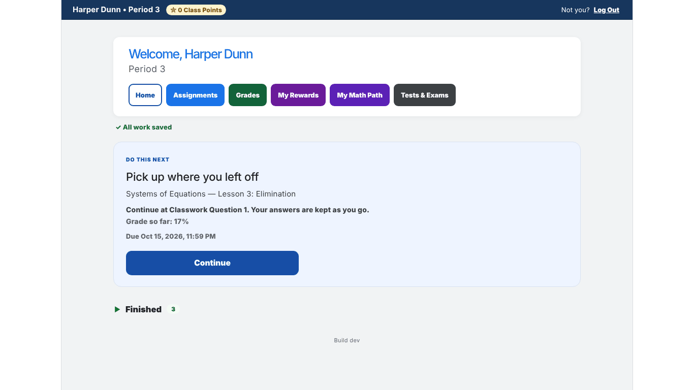
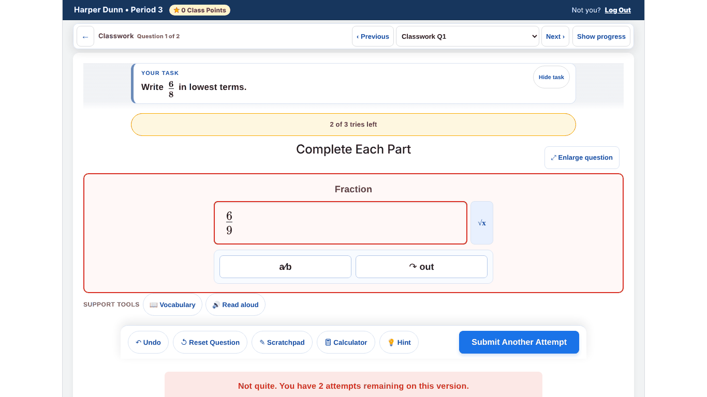
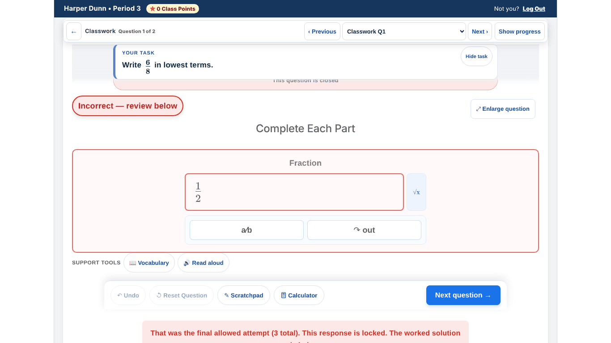
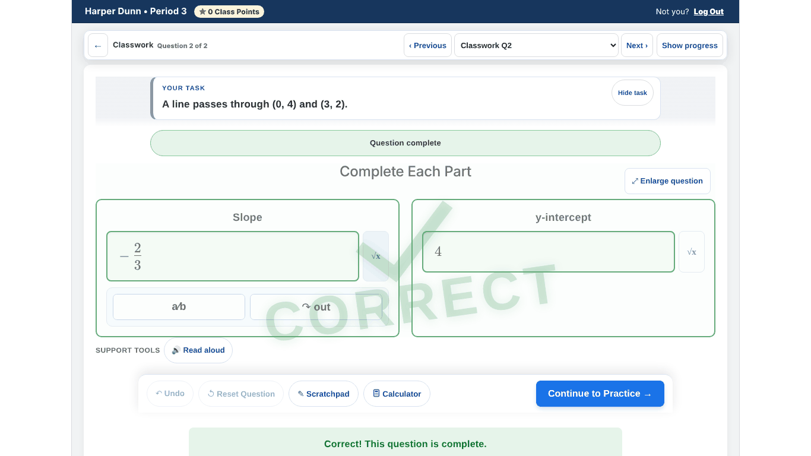
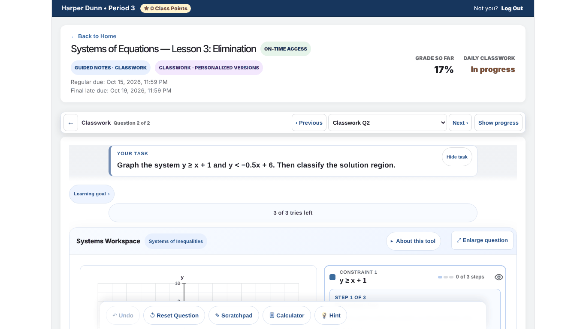
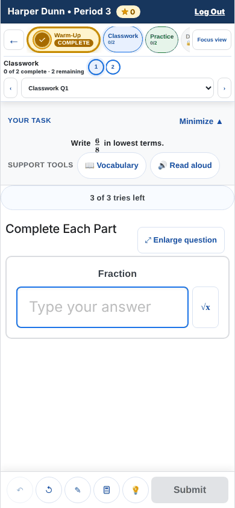
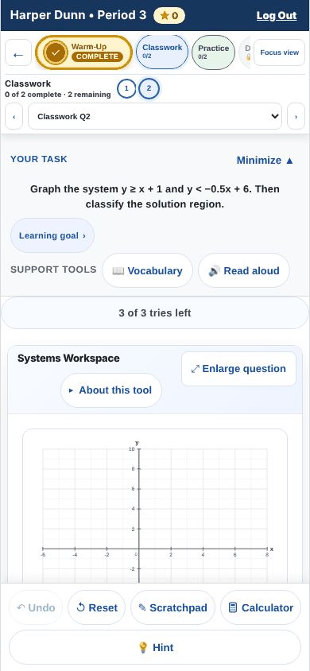
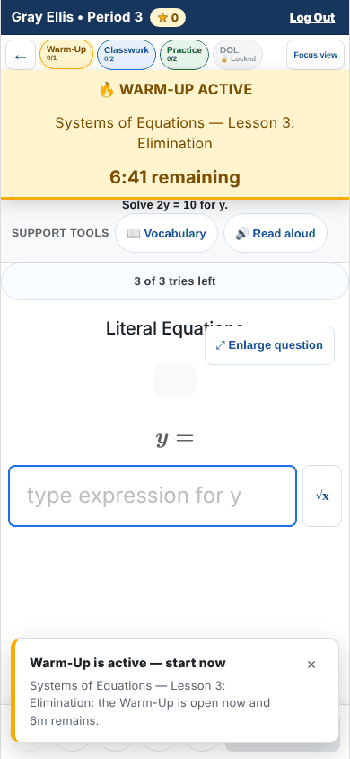

# Student experience pass 3 — live walkthrough

Part of [student-experience-pass-3.md](../student-experience-pass-3.md). Run on 2026-10-16 against main at `25250b4`.

The real `App.jsx` ran in the repo's in-memory harness: every `firebase/*` import is replaced by the fakes in
`tests/browser/teacherWorkflow/`, so nothing reached a Firebase project and no real student data was involved.
The student was the synthetic Harper (910001, Algebra II Period 3) unless noted. Viewports: 1366×768
(Chromebook) and 390×844 (phone, touch). Chromium via Playwright, with the harness's school clock
(`schoolClock.mjs`).

## How to re-run it

```bash
npm ci
TEACHER_HARNESS_PORT=5188 npx vite --config tests/browser/accessibilityAppHarness.vite.config.mjs
# then open, as a student:
#   http://127.0.0.1:5188/?reset=1&questions=real&as=student&studentId=910001      (math fields, multi-part, system, ordered pair)
#   http://127.0.0.1:5188/?reset=1&questions=systems&as=student&studentId=910001   (Systems Workspace questions)
#   add &p3StartMin=3 and studentId=910008 to catch the Warm-Up window open
```

Deep links work too, for example `/assignments/a-today/classwork/1?reset=1&questions=real&as=student&studentId=910001`.
A fresh browser context per probe matters: answers persist on the device, so a reload does not reset a question.

## What was walked

- Home, Assignments, Grades, My Rewards, Tests & Exams, Live Challenge, and two result pages, at both sizes.
- Classwork Q1 ("Write 6/8 in lowest terms"): three wrong answers, the hint panel, "Show a hint",
  "Try a similar one", the final-attempt state and the worked solution.
- Classwork Q2 (slope and y-intercept): sign, reciprocal and point-form mistakes; Vocabulary, Read aloud,
  "Ask my teacher"; then both questions right to reach the section milestone.
- The Systems Workspace inequality question: normal page, "Focus view", and Work View ("Enlarge question").
- Keyboard: skip link, focus after changing screens, Tab order through the Systems Workspace.
- axe-core (WCAG 2.0–2.2 A/AA plus best-practice rules) on nine screens.

## Findings

| # | Finding | Evidence | Sev |
| --- | --- | --- | --- |
| LIVE-1 | Phone: after a wrong Submit the "Not quite…" message sits at y=869–988 on an 844px screen with 0px visible; neither a wheel nor a scroll of the workspace reveals it (document height stays 844). After the final try the screen says "Incorrect — review below", but the worked solution is at y=1244 and unreachable. Chromebook: the message lands under the sticky action bar. | `phone-miss-unreachable.png`, `phone-final-solution-unreachable.png`, `miss-feedback-under-bar.png` | P0 |
| LIVE-2 | After the final miss the order is: red banner → a large "Next Question — press Enter again to continue" card (focused) → "This response is closed after 3 attempts" → the worked solution, below the fold. The student's answer is never shown next to the correct one. | `final-attempt-solution-below.png`; QuestionEngine.jsx:2636–2668 before 2680–2699 | P1 |
| LIVE-3 | Miss feedback is generic. "Not quite. You have 2 attempts remaining on this version. Focus on: Fraction." on a one-box question. Slope 2/3 (sign slip) and −3/2 (reciprocal) for −2/3 get the same "Focus on: Slope"; "(0, 4)" for the y-intercept is wrong with no word about the expected form. The partial-credit line ("1 of 2 parts right — still to fix: Slope") is good. | probes on Classwork Q2 | P1 |
| LIVE-4 | The help panel's first line runs under the "Enlarge question" button ("Using one is noted with your attemp…"). | `help-panel-overlap.png`, `ask-my-teacher.png` | P2 |
| LIVE-5 | A hint plus "Try a similar one" pushes the answer box to y≈916 on a 768px screen. | wrong-answer walk | P2 |
| LIVE-6 | "Focus view" scrolls the page to the top: the Systems graph moved from 491px to 619px down (707px after "Show progress"). Work View, labelled "Enlarge question", shows the whole tool (graph 206–601px). | `focus-view-scrolls-away.png`, `work-view.png`; App.jsx:9980–9989 only flips state | P1 |
| LIVE-7 | Chromebook, Systems Workspace on load: about 215px of graph above the action bar; the constraint steps below the fold. The navigator carries three lines of ~9px uppercase grade text. | `systems-chromebook-load.png` | P2 |
| LIVE-8 | Phone: the DOL tab is clipped under "Focus view"; Prev/Next arrows are 23×34px; the work bar is icon-only on one question and two rows (a full-width Hint row) on the Systems question. | `phone-workspace.png`, `phone-systems.png` | P2 |
| LIVE-9 | "Ask my teacher" answers "Your hand is raised on your teacher's live class screen for this question. Keep working while you wait." It is offered on every non-practice assignment at any hour (App.jsx:10235, QuestionEngine.jsx:1501), carries no message, and is lowered when the student leaves (helpRequest.js). | `ask-my-teacher.png` | P1 |
| LIVE-10 | The locked DOL tab is a disabled button whose reason is only a `title` tooltip ("DOL is not available yet."), unreachable by keyboard or touch (App.jsx:9925–9944). Overview says "Locked until DOL window"; only the results page gives the time ("opens at 11:35 AM"). | section tabs | P2 |
| LIVE-11 | After Enter on "Grades" in the student nav, focus is on `<body>` and nothing is announced except the title change. | keyboard probe | P1 |
| LIVE-12 | No `<main>` landmark on Home, Assignments, Grades, Rewards or Live (axe `landmark-one-main`); the workspace nests two `<main>` elements (App.jsx:10167 and MobileViewportContainer.jsx:501). The Live Challenge waiting screen has no h1 and no student nav, and says "Back to Dashboard". | axe table below | P2 |
| LIVE-13 | Contrast: the section tab's "COMPLETE" badge is 9px bold white on #a66b00 (4.44:1, needs 4.5:1); the math-field placeholder is 1.66:1. The classroom math field's inner keyboard sink has no accessible name (`aria-input-field-name`). | axe table below | P2 |
| LIVE-14 | Phone, Warm-Up window open (910008, `p3StartMin=3`): a ~140px "WARM-UP ACTIVE · 6:41 remaining" banner covers the top of the task card, and a "Warm-Up is active — start now" toast sits over the work bar and Submit for several seconds. Submit itself stays on screen (y=792). | `phone-warmup-banner.png` | P2 |
| LIVE-15 | "Complete Each Part" heads a one-box question; the "↷ out" key label is cryptic; the "√x" button opens the math keypad but reads as "insert square root"; two Back controls in the assignment header ("← Back to Home", 106×15px, and "←" named "Back to dashboard"). | `phone-workspace.png` | P3 |
| LIVE-16 | Phone: the six coloured nav buttons wrap to three rows (~200px) above every screen. Assignments' filter chips read "Closed — try again · 1" over "…or with a Recovery open — all still open and still counting". | `phone-assignments-nav.png` | P3 |
| LIVE-17 | Grading guardrail: a `multiAnswer` field does not enforce lowest terms, so 6/8, 12/16 and 0.75 were all accepted for the harness item "Write 6/8 in lowest terms". The lowest-terms rule exists only for the `fraction` type (functions/shared/ordinaryResponseGrading.mjs ~140–160). No lesson in the repo uses this shape, so a Pre-Flight warning is enough. | probes on Classwork Q1 | P3 |

## axe results (1366×768)

The repo's accessibility ratchet runs WCAG tags only (`scripts/accessibility-baseline.json` is empty), so
best-practice landmark rules are not watched, and its scenes never render a completed section tab.

| Screen | Rules violated (impact × nodes) |
| --- | --- |
| Home `/` | landmark-one-main (moderate ×1), region (moderate ×1) |
| Assignments | heading-order (moderate ×1), landmark-one-main (×1), region (×6) |
| Grades | landmark-one-main (×1), region (×2) |
| My Rewards | landmark-one-main (×1) |
| Tests & Exams | none |
| Live Challenge | landmark-one-main (×1), page-has-heading-one (×1), region (×1) |
| Assignment result | none |
| Workspace, Classwork Q1 | aria-input-field-name (serious ×1), color-contrast (serious ×3), landmark-main-is-top-level, landmark-no-duplicate-main, landmark-unique (moderate ×1 each) |
| Workspace, Practice Q1 (system) | aria-input-field-name (serious ×1), color-contrast (serious ×1), the same three landmark rules |

## Working well, seen live

- Home's "Do this next" card names the exact question to continue at; refresh and deep links land on the same question.
- Progressive hints with Read aloud and "Show the next hint"; "Try a similar one" is a worked example with
  different numbers and says so.
- "See why it works" after a correct answer, and a clear section milestone ("Classwork complete — Continue to Practice →").
- Reset Question asks first and keeps attempt history (QuestionEngine.jsx:1405–1441).
- Work View fits the whole Systems Workspace on a Chromebook, task in the header.
- Per-part red/green marking and "still to fix: Slope".
- Screen-reader announcements for question changes, tries left and results; page titles per screen; the skip link lands on the first heading.

## Screenshots

| | |
| --- | --- |
|  |  |
|  |  |
|  |  |
|  |  |
|  |  |
|  |  |
|  |  |
|  |  |
